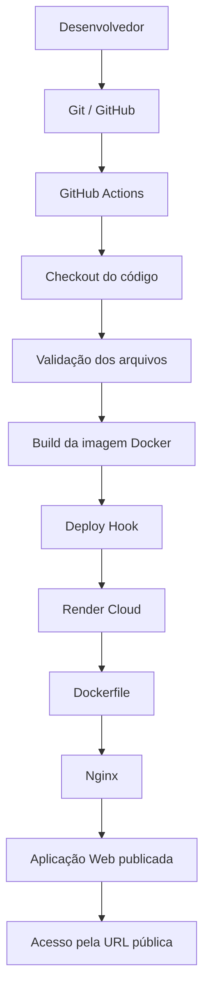

# 🏗️ Arquitetura do Projeto — Pipeline CI/CD

## 1. Visão geral

O projeto utiliza uma arquitetura simples de DevOps, integrando ferramentas de versionamento, automação de processos, conteinerização e hospedagem em nuvem.

O objetivo é automatizar o processo de validação e publicação de uma aplicação web desenvolvida em HTML5 e CSS3.

## 2. Diagrama de arquitetura

## 3. Componentes da arquitetura

### Git e GitHub
Responsáveis pelo versionamento e armazenamento do código-fonte da aplicação. As alterações enviadas para a branch `main` iniciam automaticamente o pipeline.

### GitHub Actions
Ferramenta responsável pela automação do pipeline CI/CD. Executa o checkout do código, valida a estrutura dos arquivos, constrói a imagem Docker e aciona o processo de deploy no Render.

### Docker
Tecnologia utilizada para conteinerizar a aplicação, proporcionando um ambiente padronizado para sua execução.

### Nginx
Servidor web responsável por disponibilizar os arquivos HTML e CSS da aplicação dentro do contêiner.

### Render Cloud
Plataforma de hospedagem em nuvem responsável por construir e executar a aplicação utilizando o Dockerfile presente no repositório.

## 4. Fluxo de funcionamento

1. O desenvolvedor realiza alterações no código-fonte.
2. As alterações são enviadas ao repositório GitHub.
3. O GitHub Actions identifica o novo commit na branch `main`.
4. O pipeline realiza o checkout e valida os arquivos necessários.
5. O pipeline constrói a imagem Docker para verificar sua integridade.
6. Após as etapas anteriores, o GitHub Actions envia uma solicitação de deploy ao Render.
7. O Render realiza a construção e publicação da aplicação utilizando o Dockerfile.
8. O Nginx inicia e disponibiliza a página web.
9. A aplicação fica acessível por meio de uma URL pública.

**Observação:** a construção da imagem pelo GitHub Actions é uma etapa de validação. O Render também constrói sua própria imagem a partir do Dockerfile do repositório durante o processo de publicação.

## 5. Resultado esperado

A arquitetura permite automatizar o fluxo de atualização e publicação da aplicação, reduzindo etapas manuais e facilitando a manutenção do projeto.

O resultado é uma aplicação web conteinerizada, publicada em ambiente de nuvem e acessível por meio de uma URL pública.

---

**Projeto acadêmico — Pipeline CI/CD com Deploy em Nuvem.**
